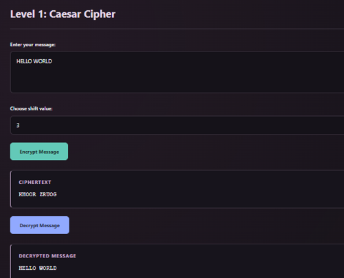
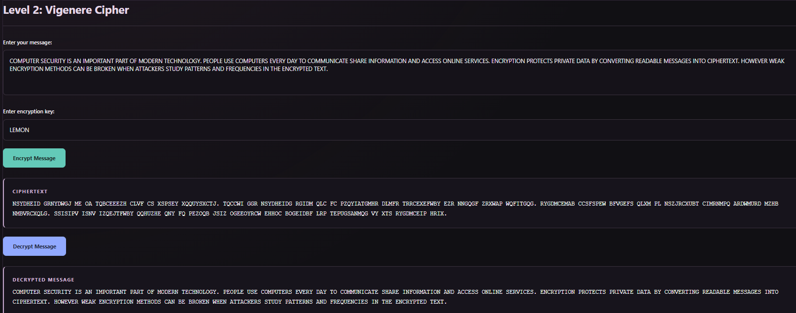
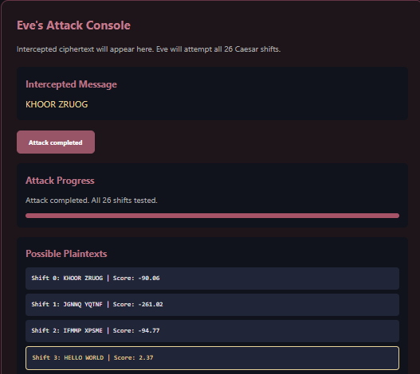
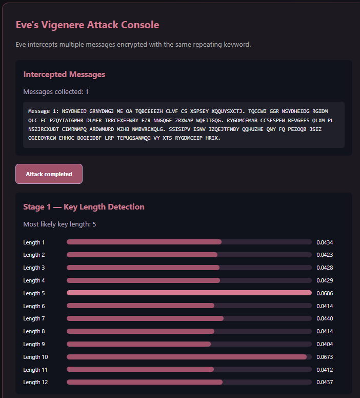

# Cipher Arms Race

### Encryption vs Decryption vs Attack

What happens when two people try to communicate securely, but someone is secretly listening?

**Cipher Arms Race** is an interactive cybersecurity project that explores this question through encryption algorithms and simulated cryptographic attacks.

The idea is simple: Alice wants to send a private message to Bob, while Eve tries to intercept and break their communication. The project begins with basic encryption techniques that are relatively easy to crack and explores how cryptographic security evolves towards modern encryption.

Instead of just explaining encryption through theory, this project aims to let you see it happen through interactive demonstrations.

---

## What's the Idea?

The project revolves around three participants:

- **Alice:** The sender who encrypts messages.
- **Bob:** The receiver who decrypts the messages.
- **Eve:** The attacker who intercepts ciphertext and attempts to recover the original message.

Each level introduces a different encryption technique. Alice and Bob use the selected algorithm to communicate, while Eve attempts a corresponding cryptographic attack.

As the levels progress, the attacks become more challenging and the encryption becomes stronger.

The goal is to understand not just how encryption works, but also why older algorithms became vulnerable and why modern cryptographic techniques are necessary.

---

## Encryption Levels

The following table distinguishes between features currently implemented and those planned for future development.

| Level | Encryption Technique | Eve's Attack | Status |
|---|---|---|---|
| 01 | Caesar Cipher | Brute-force attack | Implemented |
| 02 | Vigenère Cipher | Index of Coincidence and frequency analysis | Implemented |
| 03 | One-Time Pad | Reused-key attack | Planned |
| 04 | Toy RSA | Integer factorization | Planned |
| 05 | RSA-OAEP + AES-GCM | No practical attack demonstrated | Planned |
| Bonus | Hybrid Encryption | Man-in-the-Middle attack | Planned |

### A Closer Look at the Implemented Levels

**Level 01 – Caesar Cipher**

We begin with one of the simplest encryption techniques. Eve tries all 26 possible shifts and ranks the resulting plaintext candidates using English letter frequencies.

**Level 02 – Vigenère Cipher**

Things get more interesting here. Since Vigenère uses a repeating keyword, Eve needs to identify the key length before attempting to recover the key. The attack uses the Index of Coincidence and frequency analysis.

### Planned Levels

The following levels represent the intended direction of the project and are not part of the currently implemented version.

**Level 03 – One-Time Pad**

The One-Time Pad is theoretically unbreakable when used correctly. But what happens when the same key is reused? This level is planned to demonstrate how key reuse can expose information about multiple messages.

**Level 04 – Toy RSA**

This level will introduce public-key cryptography using small RSA keys. Eve will attempt to factor the public modulus and derive the private key.

**Level 05 – Modern Hybrid Encryption**

This level is planned to combine RSA-OAEP with AES-GCM using the browser's built-in Web Crypto API. It will demonstrate how modern cryptographic primitives can be used together.

**Bonus – Man-in-the-Middle Attack**

Strong encryption alone isn't enough if public keys cannot be trusted. This planned demonstration will explore what happens when an attacker substitutes a public key during communication.

---

## Screenshots

### Level 01 – Caesar Cipher



### Level 02 – Vigenère Cipher



### Eve's Attack Demonstrations

**Caesar Brute-Force Attack**



**Vigenère Cryptanalysis**



---

## Technologies Used

| Technology | Purpose |
|---|---|
| HTML | Structure of the application |
| CSS | Styling and visual design |
| JavaScript | Encryption, decryption and attack logic |
| Chart.js | Data visualization |

---

## Project Structure

```text
cipher-arms-race/
│
├── docs/
│   └── design.md
│
├── frontend/
│   ├── index.html
│   ├── script.js
│   └── style.css
│
├── images/
│   ├── cipher-caesar.png
│   ├── cipher-eve-caesar.png
│   ├── cipher-eve-vigenere.png
│   └── cipher-vigenere.png
│
├── server/
│
├── tests/
│
└── README.md
```

---

## How the Application Works

The current implementation focuses on interactive encryption and cryptanalysis demonstrations.

- Alice encrypts messages using the selected cipher.
- Bob decrypts messages using the appropriate key.
- Eve analyses encrypted messages and attempts to recover the original plaintext.

The current working version demonstrates Caesar and Vigenère encryption and their corresponding attacks.

---

## What Makes This Project Interesting?

Rather than presenting encryption algorithms as isolated implementations, Cipher Arms Race connects them through a single interactive story.

Some of the concepts explored through the project include:

- How brute-force attacks work.
- How letter-frequency patterns can reveal information about encrypted messages.
- Why repeating-key encryption can be vulnerable to statistical attacks.
- How RSA security relates to the difficulty of integer factorization.
- Why modern encryption uses a combination of symmetric and asymmetric cryptography.
- Why public-key authentication matters in secure communication.

The implemented levels also include visual representations of attack progress, possible plaintext candidates and statistical analysis.

---

## Security Considerations

Security is an important part of the project itself.

The project considers practices such as:

- Displaying user messages using `textContent` instead of `innerHTML`.
- Limiting message sizes.
- Rate-limiting incoming requests.
- Using random, temporary room identifiers.
- Avoiding message storage on the relay server.
- Keeping plaintext and secret keys out of relay messages.

These are educational design considerations and should not be interpreted as a guarantee that the application is production-secure.

---

## Limitations

Cipher Arms Race is an educational project, not a production-ready secure messaging application.

- The implemented classical encryption levels intentionally use weak algorithms.
- Vigenère cryptanalysis requires sufficient ciphertext. Very short messages may not provide enough statistical information.
- The planned RSA factorization demonstration would use small keys and would not represent attacks on real 2048-bit RSA keys.
- Modern encryption demonstrations would illustrate established cryptographic primitives, not constitute a complete security audit or proof of security.
- The project does not claim to provide secure real-world messaging.

---

## Future Improvements

Planned improvements include:

- Implementing the One-Time Pad and reused-key demonstration.
- Introducing a Toy RSA encryption and factorization level.
- Exploring modern hybrid encryption using RSA-OAEP and AES-GCM.
- Adding a Man-in-the-Middle attack demonstration.
- Improving attack visualizations and interactive explanations.
- Expanding the project with additional cryptographic experiments.

---

## Learning Outcomes

Building this project provides practical exposure to classical cryptography, cryptanalysis, public-key encryption, symmetric encryption and secure communication.

More importantly, it demonstrates an important lesson in cybersecurity:

**Encryption is not just about hiding information. It's also about understanding how that information can be attacked, what makes an algorithm vulnerable, and how better security mechanisms address those weaknesses.**

---

*Built as a hands-on exploration of cryptography, encryption and cryptanalysis.*